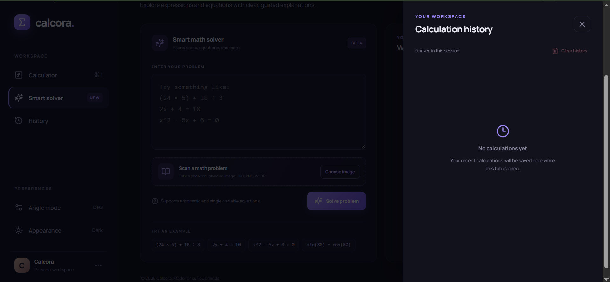

# 🧮 Calcora — Modern Calculator and Mathematical Solver


A **modern, web-based calculator and mathematical problem-solving application** designed to make calculations easier, faster, and more accessible.

Calcora combines standard arithmetic operations, scientific calculations, equation solving, mathematical expression evaluation, and image-based problem recognition in one organized interface.

Built using React and Vite, the application provides a responsive and interactive environment for students, educators, and individuals who need a convenient tool for solving mathematical problems.

---

# 🖥️ Application Preview

<table>
  <tr>
    <td align="center">
      
      <br>
      <b>Standard and Scientific Calculator</b>
    </td>
    <td align="center">
      
      <br>
      <b>Smart Mathematical Solver</b>
    </td>
  </tr>
  <tr>
    <td align="center" colspan="2">
      
      <br>
      <b>Calculation History</b>
    </td>
  </tr>
</table>

---

# 📌 Overview

Mathematics is an essential part of everyday activities, education, and problem-solving. However, performing complex calculations, understanding mathematical expressions, and solving equations can sometimes be challenging.

Calcora was developed to provide a centralized mathematical tool that combines multiple calculator functions with a dedicated problem-solving interface.

The application goes beyond basic arithmetic by providing scientific functions, equation-solving capabilities, and image-based mathematical input. Users can enter mathematical expressions manually or submit a picture of a problem for text recognition and processing.

Calcora also emphasizes the importance of mathematical accuracy by following standard operator precedence, including the **PEMDAS rule**, when evaluating mathematical expressions.

The application is designed primarily for students, educators, and general users who want a convenient and accessible mathematical calculator.

---

# ✨ Features

- 🧮 **Standard Calculator** — Perform basic arithmetic operations, including addition, subtraction, multiplication, and division.
- 🔬 **Scientific Calculator** — Access advanced mathematical functions such as trigonometry, logarithms, exponents, roots, and factorials.
- 🧠 **Smart Mathematical Solver** — Enter or paste mathematical expressions and supported equations to calculate their results.
- 📸 **Image-Based Problem Recognition** — Upload a picture or use a compatible device camera to capture a mathematical problem for text recognition.
- 🔎 **Optical Character Recognition (OCR)** — Extract mathematical text from uploaded images using Tesseract.js.
- ✏️ **Editable Recognized Expressions** — Review and correct extracted mathematical text before submitting it to the solver.
- 📐 **PEMDAS-Based Evaluation** — Follow standard mathematical order of operations when evaluating expressions.
- 📝 **Step-by-Step Solutions** — Display supported mathematical transformations in an organized sequence rather than relying only on a final answer.
- ➗ **Linear Equation Solver** — Solve supported single-variable linear equations.
- 📊 **Quadratic Equation Solver** — Process supported quadratic equations and calculate their solutions.
- 📈 **Scientific Angle Modes** — Switch between degrees and radians for trigonometric calculations.
- π **Mathematical Constants** — Access commonly used constants, including pi (π) and Euler's number (e).
- ↩️ **Calculation History** — Review previous calculations and their corresponding results.
- 🌓 **Dark and Light Modes** — Switch between available interface appearances.
- 🎨 **Modern User Interface** — Enjoy an organized design with interactive controls and smooth visual transitions.
- 📱 **Responsive Layout** — Designed to accommodate desktop, tablet, and mobile screen sizes.

---

# 🛠️ Technologies Used

## Frontend Development

- React.js
- JavaScript (ES6+)
- HTML5
- CSS3

## Development and Build Tools

- Vite
- npm
- Node.js

## Mathematical Processing

- **Math.js** — Used for parsing, evaluating, and processing mathematical expressions.
- **Nerdamer** — Used for symbolic mathematical computation and supported equation-solving operations.

## Image Recognition

- **Tesseract.js** — Provides Optical Character Recognition (OCR) functionality to extract text from uploaded images.

## Development Tools

- Visual Studio Code
- Git
- GitHub
- Modern Web Browser

---

# 🚀 Installation and Setup

Follow these instructions to install and run Calcora locally.

## Prerequisites

Before installing the project, ensure that the following tools are available on your computer:

- [Node.js](https://nodejs.org/)
- npm (included with Node.js)
- [Git](https://git-scm.com/) (optional, for cloning the repository)
- Visual Studio Code or another code editor

## 1. Clone the Repository

Replace `your-username` with your GitHub username.

```bash
git clone https://github.com/your-username/Calcora.git
```

## 2. Navigate to the Project Folder

```bash
cd Calcora
```

## 3. Open the Project in Visual Studio Code

```bash
code .
```

Alternatively, open Visual Studio Code manually and select the Calcora project folder.

## 4. Install Dependencies

Install the required project dependencies using npm.

```bash
npm install
```

If you are using Windows PowerShell and encounter an execution-policy error when running `npm`, use:

```powershell
npm.cmd install
```

## 5. Run the Application Locally

Start the Vite development server.

```bash
npm run dev
```

Alternatively, on Windows PowerShell:

```powershell
npm.cmd run dev
```

## 6. Open Calcora in Your Browser

Once the development server has started, open the local URL displayed in your terminal.

The default Vite development address is:

```text
http://localhost:5173/
```

**Note:** An internet connection may be required for the initial installation of dependencies and for loading the OCR language data used by Tesseract.js. The application itself runs locally through the browser during development.

---

# 📖 How to Use Calcora

## 1. Standard Calculator

The Standard Calculator provides the basic mathematical operations needed for everyday calculations.

1. Open Calcora.
2. Enter numbers using the calculator buttons or supported keyboard inputs.
3. Select the required arithmetic operators.
4. Use parentheses when grouping mathematical expressions.
5. Press the equals button to calculate the result.
6. Use the clear or backspace functions to modify your input.

Supported operations include addition, subtraction, multiplication, division, percentage calculations, and decimal arithmetic.

## 2. Scientific Calculator

The Scientific Calculator provides additional mathematical functions for more advanced calculations.

Available functions include:

- Sine (sin)
- Cosine (cos)
- Tangent (tan)
- Inverse trigonometric functions
- Logarithm (log)
- Natural logarithm (ln)
- Exponents and powers
- Square roots and other root operations
- Factorials
- Mathematical constants

Users can also select the appropriate angle mode when performing trigonometric calculations.

- **DEG:** Uses degrees.
- **RAD:** Uses radians.

Always check the selected angle mode before performing trigonometric calculations.

## 3. Smart Mathematical Solver

The Smart Solver allows users to enter mathematical expressions and supported equations.

1. Navigate to the Smart Solver section.
2. Enter or paste a mathematical expression or equation.
3. Submit the problem for processing.
4. Review the calculated result.
5. Examine the available step-by-step solution.

The solver is designed to process mathematical input and provide a more organized view of the solution.

Supported equation types include common single-variable linear and quadratic equations.

## 4. Image-Based Mathematical Problem Recognition

Calcora provides image-based input to make entering mathematical problems more convenient.

Users can upload an existing image or capture a picture using a compatible device camera.

### How to Use Image Recognition

1. Open the Smart Solver.
2. Select the image upload or camera option.
3. Choose an image from your device or take a picture of the mathematical problem.
4. Allow Calcora to process the image using OCR.
5. Review the extracted mathematical expression.
6. Correct any incorrectly recognized symbols or numbers.
7. Submit the expression to the solver.
8. Review the calculated answer and available solution steps.

### Tips for Better Recognition

For improved OCR results:

- Capture the entire mathematical problem.
- Use sufficient lighting.
- Keep the camera steady.
- Avoid blurry or distorted images.
- Make sure mathematical symbols are clearly visible.
- Avoid unnecessary backgrounds and shadows.
- Review the extracted expression before solving.

**Important:** OCR recognizes text from images, but it may incorrectly interpret handwritten expressions, fractions, exponents, roots, or special mathematical symbols. Always verify the recognized expression before using its result.

## 5. Understanding PEMDAS

Calcora follows the standard mathematical order of operations when evaluating expressions.

PEMDAS stands for:

| Letter | Meaning | Description |
|---|---|---|
| P | Parentheses | Evaluate expressions inside parentheses first. |
| E | Exponents | Evaluate powers and roots. |
| MD | Multiplication and Division | Perform multiplication and division from left to right. |
| AS | Addition and Subtraction | Perform addition and subtraction from left to right. |

### Example

Consider the following expression:

```text
8 + 2 × (6 - 3)² ÷ 3
```

The correct evaluation follows these steps:

**Step 1: Parentheses**

```text
6 - 3 = 3
```

The expression becomes:

```text
8 + 2 × 3² ÷ 3
```

**Step 2: Exponents**

```text
3² = 9
```

The expression becomes:

```text
8 + 2 × 9 ÷ 3
```

**Step 3: Multiplication**

```text
2 × 9 = 18
```

The expression becomes:

```text
8 + 18 ÷ 3
```

**Step 4: Division**

```text
18 ÷ 3 = 6
```

The expression becomes:

```text
8 + 6
```

**Step 5: Addition**

```text
8 + 6 = 14
```

<details>
<summary><b>Final Answer: 14</b></summary>

The correct answer is **14** because the expression follows the standard mathematical order of operations.

</details>

**Important:** Multiplication and division have equal precedence and must be evaluated from left to right. Addition and subtraction also have equal precedence and must be evaluated from left to right.

## 6. Step-by-Step Solutions

The Smart Solver is designed to display mathematical working in an organized sequence.

Instead of showing only a general explanation, supported operations should be presented as individual mathematical transformations.

For example:

```text
Expression:
8 + 2 × (6 - 3)² ÷ 3

Step 1:
8 + 2 × 3² ÷ 3

Step 2:
8 + 2 × 9 ÷ 3

Step 3:
8 + 18 ÷ 3

Step 4:
8 + 6

Final Answer:
14
```

The purpose is to help users understand how an expression is evaluated, including which operation is performed first and how the expression changes after each step.

The availability and detail of the walkthrough depend on the type of mathematical problem being processed.

## 7. Calculation History

The History section allows users to review their previous calculations.

1. Navigate to the History section.
2. Review previously recorded expressions and results.
3. Refer to earlier calculations when needed.

Calculation history is intended to make reviewing previous mathematical operations more convenient.

---

# ⚙️ Core Modules

Calcora is organized into several functional modules.

- **Calculator Module:** Handles standard arithmetic operations, mathematical input, and result display.
- **Scientific Calculator Module:** Provides advanced mathematical functions, constants, and angle-mode selection.
- **Smart Solver Module:** Processes mathematical expressions and supported equations.
- **Equation-Solving Module:** Handles supported linear and quadratic equation-solving operations.
- **Image Recognition Module:** Processes uploaded or captured images and extracts mathematical text through OCR.
- **Step-by-Step Solution Module:** Organizes supported mathematical operations into sequential solution steps.
- **Calculation History Module:** Displays previously performed calculations.
- **Interface and Appearance Module:** Manages responsive layouts, interactive components, and available appearance modes.

---

# 📂 Project Structure

```text
Calcora/
│
├── src/
│   ├── App.jsx
│   ├── main.jsx
│   └── styles.css
│
├── images/
│   ├── Calculator.PNG
│   ├── Smart Solver.PNG
│   └── History.PNG
│
├── .env.example
├── .gitignore
├── CONTRIBUTING.md
├── LICENSE
├── README.md
├── index.html
├── package.json
└── vite.config.js
```

### File Descriptions

| File / Folder | Purpose |
|---|---|
| `src/` | Contains the main application source code. |
| `src/App.jsx` | Main React application component and calculator functionality. |
| `src/main.jsx` | React application entry point. |
| `src/styles.css` | Application styling, layout, animations, and responsive design. |
| `images/` | Stores screenshots used in the project documentation. |
| `images/Calculator.PNG` | Screenshot of the calculator interface. |
| `images/Smart Solver.PNG` | Screenshot of the Smart Solver interface. |
| `images/History.PNG` | Screenshot of the calculation history interface. |
| `.env.example` | Example environment configuration file. |
| `.gitignore` | Specifies files and folders excluded from Git tracking. |
| `CONTRIBUTING.md` | Provides guidelines for contributing to Calcora. |
| `LICENSE` | Contains the project's license. |
| `README.md` | Project overview, features, installation instructions, and documentation. |
| `index.html` | Main HTML document used by Vite. |
| `package.json` | Contains project metadata, dependencies, and npm scripts. |
| `vite.config.js` | Vite development and build configuration. |

---

# ⚠️ Limitations and Important Notes

Calcora is a browser-based mathematical calculator and solver. Although it provides several mathematical features, certain limitations currently apply:

- Mathematical expression processing is limited to the supported syntax and functions of the implemented mathematical libraries.
- Equation solving is limited to the equation types and variable configurations supported by the solver.
- OCR accuracy depends on image quality, handwriting, lighting, and mathematical notation.
- Some handwritten expressions and complex mathematical symbols may not be recognized correctly.
- Extracted mathematical expressions should be reviewed and corrected before solving.
- The step-by-step solution feature depends on the supported mathematical operations and may not provide a complete formal mathematical proof for every expression.
- Arbitrary word problems are not automatically interpreted as mathematical models.
- Complex symbolic expressions may not always produce a complete or simplified result.
- Image recognition may require an internet connection to retrieve OCR language data.
- Results should be checked when used for academic, scientific, or other accuracy-sensitive purposes.

---

# 🔮 Future Improvements

Possible future enhancements for Calcora include:

- Improved OCR accuracy for handwritten mathematical problems.
- Better recognition of fractions, exponents, matrices, and square roots.
- Image cropping, rotation, and adjustment before recognition.
- More advanced algebraic equation-solving capabilities.
- More detailed mathematical solution walkthroughs.
- Improved step-by-step explanations for linear and quadratic equations.
- Graphing functions and interactive mathematical visualizations.
- Support for additional mathematical topics and operations.
- Improved keyboard navigation and accessibility.
- Additional calculator customization options.
- Optional AI-powered mathematical explanations through a secure backend integration.
- Improved mobile camera and image-processing experience.

These are proposed enhancements and are not necessarily available in the current version.

---

# 🤝 Contributing

Contributions, suggestions, bug reports, documentation updates, and feature improvements are welcome.

If you would like to contribute to Calcora, please read [CONTRIBUTING.md](CONTRIBUTING.md) for guidelines on setting up the development environment, following coding standards, reporting bugs, and submitting pull requests.

---

# 📄 License

This project is distributed under the license included in the repository.

See the [LICENSE](https://github.com/rheillunio2-byte/Calcora?tab=MIT-1-ov-file) file for the applicable terms and conditions.

---

# 👨‍💻 Developer

**Rheil Evans T. Lunio**

GitHub: [https://github.com/rheillunio2-byte](https://github.com/rheillunio2-byte)

---

**Calcora — Making mathematical problem-solving simpler, smarter, and more accessible.**